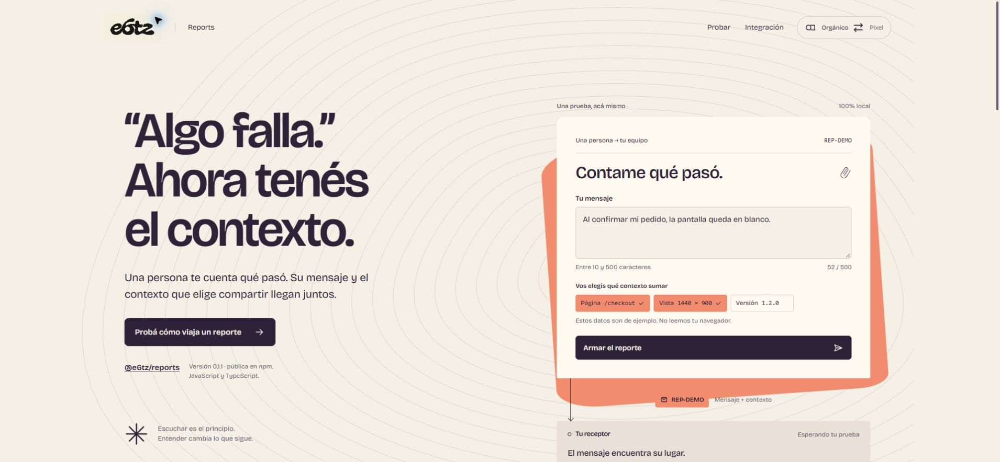

# Reports (`@e6tz/reports`)

[Sitio web](https://reports.6tz.tech) · [npm: @e6tz/reports](https://www.npmjs.com/package/@e6tz/reports) · [MIT](LICENSE)

[](https://reports.6tz.tech)

Enviá reportes de texto e imagen a un receptor configurable. Este paquete tiene su propia versión e instalación.
El núcleo funciona en JavaScript y TypeScript sin React, Toolkit ni Performance.

Reports, Flags y Toolkit son bibliotecas independientes para integrar en una aplicación anfitriona, no aplicaciones completas.
Comparten el mismo reparto de responsabilidades, aunque sus interfaces son distintas.
Reports no incluye cuentas, inicio de sesión, un receptor remoto ni almacenamiento de reportes.

## Integrar en una aplicación anfitriona

La anfitriona controla la interfaz, la activación, la autenticación, los permisos, el backend y los secretos.
Mantenga la función desactivada por defecto en su configuración. Actívela explícitamente cuando la integración esté preparada.
Ese interruptor pertenece a la anfitriona; no es una opción de Reports ni sustituye la autorización del servidor.

1. Implemente una ruta receptora propia, por ejemplo `POST /api/reports`, con el [contrato HTTP](#contrato-http).
2. Configure cómo autenticar las solicitudes y autorizar el proyecto y la operación en ese backend.
3. Inyecte el transporte en el cliente. Muestre el formulario sólo cuando la configuración y los permisos lo permitan.
4. Envíe únicamente desde una acción explícita de la persona. Ofrezca el reintento como otra acción explícita.
5. Al cerrar sesión, perder permisos o desmontar la integración, oculte la interfaz y ejecute `dispose()` sobre el cliente que posee.

Importar el paquete, construir el cliente o montar `ReportForm` no envía reportes por sí solo.
`prepare()` valida y congela los datos; `send()` inicia la entrega y `retry()` reenvía el mismo intento preparado.
La selección de una imagen y la recopilación de contexto también son explícitas.

### Autenticación de la anfitriona

**El transporte HTTP usa `credentials: "omit"`, incluso con `/api/reports` en el mismo origen.**
Una ruta relativa no transmite automáticamente las cookies de la sesión ni convierte la solicitud en autenticada.
La anfitriona debe proporcionar las cabeceras de autenticación mediante `headers`, o integrar su propio `fetch` o transporte.
Si necesita cookies, configure esa decisión explícitamente en el adaptador de la anfitriona y aplique protección CSRF.
Consulte [cómo inyectar otro transporte](#inyectar-otro-transporte) para conservar el contrato de entrega.

Reports no incluye gestión de cuentas ni emisión, renovación o persistencia de credenciales.
No incluya secretos administrativos ni credenciales de larga duración en el navegador.
Si utiliza credenciales de alcance limitado, su emisión, vigencia y autorización corresponden a la anfitriona.

### Preparar el backend receptor

La ruta `/api/reports` es sólo un ejemplo: este paquete no la crea ni ofrece un servicio alojado.
Antes de guardar un reporte, el backend de la anfitriona debe:

- Autenticar la solicitud y autorizar su proyecto y operación. Derivar la identidad del contexto verificado del servidor, no del cuerpo enviado.
- Aplicar validación de origen, CORS y CSRF según su mecanismo de autenticación. Estos controles no sustituyen los permisos.
- Validar de nuevo el cuerpo, el texto y la imagen con los [límites del contrato](#contrato-http), y aplicar cuotas y límites de frecuencia.
- Deduplicar atómicamente `submissionId` dentro del ámbito autorizado. Devolver 409 si el mismo identificador tiene contenido diferente.
- Confirmar la recepción sólo después de persistir el reporte de forma duradera. Responder con `{data: Acknowledgement}` según el contrato.

Un HTTP 429 puede indicar `Retry-After`; el cliente espera ese plazo y requiere otro reintento explícito.
Un HTTP 2xx sin ACK válido no confirma la entrega. Consulte los estados en la [referencia](#referencia-de-api).
`cancel()` y `dispose()` detienen el intento local, pero no retiran un reporte que el servidor ya recibió.

## Instalar y conectar

Instale el paquete público desde npm:

```sh
npm install @e6tz/reports
```

El código se distribuye bajo la [licencia MIT](LICENSE).

Requisitos: Node.js 20.9 o posterior, npm y Git para instalar desde el repositorio.

Instalá desde GitHub:

```sh
npm install git+https://github.com/Enry6tz/reports.git#main
```

El script `prepare` compila el paquete durante la instalación desde Git. Para fijar una revisión, reemplazá `main` por su SHA de commit.

También podés generar un archivo local desde este repositorio:

```sh
git clone https://github.com/Enry6tz/reports.git
cd reports
npm install
npm test
npm pack
```

En la aplicación consumidora, instalá el archivo generado:

```sh
npm install /ruta/al/archivo/e6tz-reports-0.1.1.tgz
```

Configure la URL de su receptor y las credenciales de la anfitriona, si corresponden, antes de habilitar la función.
Este ejemplo no envía durante la inicialización. La anfitriona debe conectar `submitReport()` a una acción de su interfaz.

```ts
import { createReportsClient, createHttpReportsTransport } from "@e6tz/reports";
import { collectReportContext } from "@e6tz/reports/browser";

const reports = createReportsClient({
  transport: createHttpReportsTransport({
    endpoint: "/api/reports",
  }),
});

let reportingEnabled = false; // Host configuration; enable only after integration and permission checks.

async function submitReport(message: string) {
  if (!reportingEnabled) return;
  reports.prepare({
    message,
    context: collectReportContext({ appVersion: "1.2.0" }),
  });
  const result = await reports.send();
  if (result.status === "accepted") {
    console.log(result.receipt.reportId);
  }
}
```

`prepare()` valida y congela el reporte, su contexto y un UUID `submissionId`.
Sólo `send()` inicia el envío. `accepted` requiere un ACK válido del receptor.
Un HTTP 2xx sin ese ACK produce `uncertain`.

Si falta la confirmación, conservá la instancia y ofrecé `reports.retry()` como acción explícita.
El reintento conserva exactamente el UUID y el contenido preparados. El receptor debe deduplicarlos.
Un conflicto HTTP 409 rechaza el intento. `retry()` no sobrescribe ese conflicto.

`cancel()` elimina el intento local. Su resultado indica si el receptor puede haberlo recibido.
`dispose()` cancela solicitudes y elimina suscriptores. Invocalo cuando termina la vida de la instancia.

## Usar el formulario en React o Next.js

Instalá React 18.3 o 19 cuando uses el subpath `@e6tz/reports/react`.
El formulario incluye mensaje, selección de imagen, estado, reintento y descarte.
Usa controles HTML accesibles. No instala CSS global y hereda la apariencia de tu aplicación.
No captura imágenes automáticamente.

En Next.js, creá un componente cliente. Este ejemplo crea y elimina cada instancia desde el mismo efecto.
También admite la repetición de efectos de React Strict Mode.
La anfitriona proporciona `enabled` tras comprobar su configuración y permisos, y `getRequestHeaders` según su autenticación.
Mantenga estable la identidad de ese callback para no recrear el cliente en cada renderizado.
Los permisos siempre deben comprobarse también en el backend; ocultar el formulario no protege la ruta receptora.

```tsx
"use client";

import { useEffect, useState } from "react";
import { createReportsClient, createHttpReportsTransport, type ReportsClient } from "@e6tz/reports";
import { ReportForm } from "@e6tz/reports/react";

interface ReportsPanelProps {
  enabled?: boolean;
  getRequestHeaders: () => HeadersInit | Promise<HeadersInit>;
}

export function ReportsPanel({ enabled = false, getRequestHeaders }: ReportsPanelProps) {
  const [client, setClient] = useState<ReportsClient | null>(null);

  useEffect(() => {
    if (!enabled) return;
    const reports = createReportsClient({
      transport: createHttpReportsTransport({
        endpoint: "/api/reports",
        headers: () => getRequestHeaders(),
      }),
    });
    setClient(reports);
    return () => {
      reports.dispose();
      setClient(null);
    };
  }, [enabled, getRequestHeaders]);

  if (!enabled) return null;
  if (!client) return <p role="status">Preparing report form…</p>;
  return <ReportForm client={client} appVersion="1.2.0" />;
}
```

Para una interfaz propia, usá `useReportsSnapshot(client)`.
`ReportForm` acepta `className`, `labels` para traducción y `onAccepted(receipt)`.
El formulario conserva el texto ante errores. Los campos permanecen bloqueados mientras existe un intento pendiente.
Descartar permite editar y preparar otro intento, aunque el anterior puede haber llegado al receptor.

## Adjuntar una imagen elegida por la persona

```ts
import { readReportImage } from "@e6tz/reports/browser";

const image = await readReportImage(file);
reports.prepare({ message: "La pantalla aparece cortada.", image });
await reports.send();
```

`readReportImage()` acepta un `Blob` o `File` PNG, JPEG o WebP de hasta 2 MiB.
Valida el tipo y la firma del archivo antes de codificarlo en base64.
La aplicación decide qué imagen adjuntar. Revisá su contenido antes del envío.

`collectReportContext()` sólo lee datos cuando lo invocás.
Recoge el pathname sin query ni fragmento, user agent, resolución de ventana, versión indicada y fecha UTC.
Podés entregar un contexto propio o evitar el helper.
Revisá los pathnames si tu aplicación incluye datos sensibles dentro de la ruta.

## Referencia de API

| Export | Contrato |
| --- | --- |
| `createReportsClient({transport, timeoutMs?, now?, createId?})` | Crea una instancia sin iniciar solicitudes. Timeout predeterminado: 10 segundos. |
| `prepare({message,image?,context?})` | Devuelve el UUID preparado. Rechaza otro intento mientras existe uno pendiente. |
| `send()` / `retry()` | Devuelve `accepted` con receipt, `uncertain`, `rejected`, `stale`, `not-ready` o `retry-later`. |
| `getSnapshot()` / `subscribe(observer)` | Estado observable sin texto ni imagen. `subscribe` devuelve la función de desconexión. |
| `cancel()` | Devuelve `not-sent`, `may-have-been-sent` o `already-acknowledged`. |
| `dispose()` | Desconecta definitivamente la instancia y elimina el intento local. |
| `createHttpReportsTransport({endpoint,headers?,fetch?,now?})` | Adapta el contrato HTTP. `headers` admite un callback síncrono o asíncrono con `{signal}`. |

Las llamadas concurrentes a `send()` comparten una solicitud.
No hay cola persistente, reintentos automáticos, recorder ni seguimiento de visitantes.
El transporte HTTP usa `credentials: "omit"`, `cache: "no-store"` y `redirect: "error"`.
Un HTTP 429 respeta `Retry-After` y espera una nueva llamada explícita a `retry()`.
Las respuestas tardías no actualizan un intento cancelado o una instancia descartada.

### Contrato HTTP

El endpoint es una URL HTTP(S) absoluta o una ruta relativa al mismo origen.
El transporte envía `POST` a la URL configurada. El receptor debe validar el origen autorizado.
El receptor debe deduplicar `submissionId` dentro de su ámbito y responder 409 si cambia el contenido.

```ts
interface Submission {
  submissionId: string;
  message: string;
  image?: { mediaType: "image/png" | "image/jpeg" | "image/webp"; data: string };
  context: {
    pathname?: string;
    browser?: string;
    viewport?: { width: number; height: number };
    appVersion?: string;
    capturedAt: string;
  };
}

interface Acknowledgement {
  submissionId: string;
  reportId: string;
  documentId: number;
  receivedAt: string;
  status: "accepted" | "duplicate";
}
```

Enviá JSON `Submission`. Respondé JSON `{data: Acknowledgement}`.
`reportId` tiene el formato `REP-n`. `documentId` es un entero positivo.
Las fechas usan ISO 8601 UTC. El ACK debe repetir el `submissionId` enviado.

Límites: mensaje de 4096 bytes UTF-8, imagen de 2 MiB decodificada, cuerpo de 3 MiB y ACK de 4096 bytes.
El pathname admite hasta 1024 bytes, navegador 512 bytes y versión 128 bytes.
El receptor debe validar de nuevo el contenido y aplicar sus permisos, cuotas y política de imágenes.

### Inyectar otro transporte

El transporte recibe el reporte congelado y `{signal}`. Devuelve el ACK directamente, sin el envelope HTTP.
Debe respetar la idempotencia y producir el ACK sólo después de persistir el reporte.
Para respuestas HTTP equivalentes, puede lanzar `ReportsTransportError(code,status,retryAt?)`.
El núcleo aplica timeout y descarta respuestas tardías aunque el transporte ignore la señal.

## Desarrollar este paquete

Desde esta carpeta, ejecutá `npm ci --ignore-scripts`, `npm run typecheck`, `npm test` y `npm run test:package`.
La verificación de paquete instala un tarball real en consumidores temporales fuera del repositorio, sin React y con React 18.3/19; comprueba imports, tipos y entrega confirmada. Requiere acceso al registro npm y conserva las carpetas temporales que muestra para inspección y limpieza manual.
GitHub Actions ejecuta los mismos controles en Node.js 22 y 24 para pushes y pull requests, sin publicar.
`npm pack` genera el archivo distribuible. La configuración de publicación es pública para el scope `@e6tz`; publicar todavía requiere confirmar su titularidad y autorizar una sesión npm. Reports se distribuye bajo la [licencia MIT](LICENSE), incluida en el paquete.
La compilación genera JavaScript ESM y declaraciones con imports `.js` compatibles con NodeNext.
Los exports raíz y `/browser` no importan React. Cada versión se empaqueta sin depender de fuentes del monorepo.
